# Diagramas

- `der.drawio` y `der.webp`: fuente editable y representación visual del modelo entidad-relación.
- `modelo-clases-uml.puml` y `modelo-clases-uml.webp`: fuente PlantUML y representación visual para consulta desde GitHub.
- `arquitectura.mmd` / `.svg` / `.png`: arquitectura de contenedores y componentes (usuario → nginx → React / Express → MySQL, WebSocket, SMTP, GitHub, BD de pruebas).
- `despliegue.mmd` / `.svg` / `.png`: flujo de ramas, CI y despliegue con Docker Compose.
- Regenerar: `mmdc -i arquitectura.mmd -o arquitectura.svg` (Mermaid CLI). GitHub también renderiza los `.mmd` pegados en un bloque ```mermaid.



